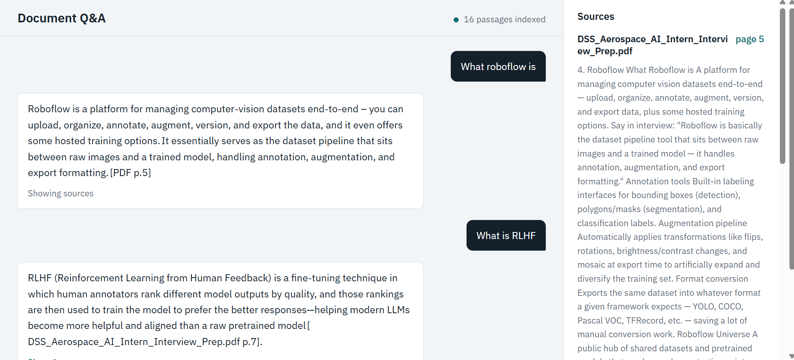
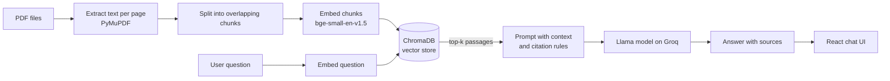

# Document Q&A with RAG and Evaluation

Ask questions about your own PDFs and get answers that cite the **file name and page** they came from. If the answer is not in the documents, the system says “I don’t know” instead of making something up.

Everything runs on free tools: local embeddings, a local vector database, and a free-tier hosted LLM.




## Features

- **Grounded answers with citations.** Every answer names the source file and page.
- **Sources panel.** The retrieved passages are shown next to the chat, so you can check the answer yourself.
- **Refuses out-of-scope questions.** Questions the documents can’t answer get “I don’t know.”
- **Built-in evaluation.** A script measures retrieval hit rate, answer accuracy, refusal accuracy and latency, so every change can be compared with numbers.
- **Free to run.** No paid services required.

## How it works



1. **Ingest:** each PDF is read page by page, split into chunks of about 400 words with a 60-word overlap, embedded, and stored in ChromaDB together with the file name and page number.
2. **Retrieve:** the question is embedded the same way and the 4 closest chunks are fetched.
3. **Generate:** the chunks and the question go to the LLM with an instruction to answer only from the context, cite sources, and say “I don’t know” when the context doesn’t cover the question.
4. **Display:** the React app shows the answer and the retrieved passages.

## Tech stack

| Part | Tool |
|---|---|
| Language | Python |
| PDF parsing | PyMuPDF |
| Embeddings | sentence-transformers (`BAAI/bge-small-en-v1.5`) |
| Vector database | ChromaDB |
| LLM | Llama model served by the Groq API |
| Backend | FastAPI |
| Frontend | React + Vite |

## Evaluation

The evaluation set has **25 questions**: 20 that the test document can answer and 5 that it can’t. `eval_rag.py` measures:

- **Retrieval hit rate:** a retrieved passage contains the facts needed for the answer.
- **Answer accuracy:** the answer contains at least one expected keyword.
- **Refusal accuracy:** out-of-scope questions get “I don’t know.”
- **Average latency:** seconds per question.

| Version | Retrieval hit rate | Refusal accuracy |
|---|---|---|
| Baseline (400-word chunks, top 4) | 70% (14/20) | 100% (5/5) |
| 150-word chunks, top 4 | _add result_ | _add result_ |
| _next experiment_ | _add result_ | _add result_ |

**What the baseline showed:** the failures were short definition questions such as “What is IoU?” and “What is mAP?”. The chunks were large and mixed many topics, which weakens retrieval for short acronym questions. Smaller chunks and hybrid (keyword + vector) search are the planned fixes.

The checks are keyword-based, so they are a fast proxy and not a perfect judge of answer quality.

## Getting started

### 1. Backend

```bash
# create and activate a virtual environment
python -m venv .venv
.venv\Scripts\activate          # Windows
# source .venv/bin/activate     # Mac/Linux

pip install -r requirements.txt
```

Create a `.env` file next to `PDF_RAG.py` (see `.env.example`):

```
GROQ_API_KEY=your_key_here
```

Get a free key from the Groq console. Never commit your real `.env` file.

Add your PDFs to a `data/` folder, then index them and start the server:

```bash
python ingest.py
uvicorn PDF_RAG:app --reload
```

Check `http://localhost:8000/health`. It should show the number of indexed chunks.

> If the model call returns “model not found”, set `LLM_MODEL` in `PDF_RAG.py` to a model available to your Groq key.

### 2. Frontend

```bash
cd frontend
npm install
npm run dev
```

Open the address shown in the terminal (usually `http://localhost:5173`).

### 3. Run the evaluation

```bash
python eval_rag.py
```

Results are printed and saved to `eval_results.csv`. The questions in `eval_rag.py` are written for the test document used in this project; replace them with questions for your own documents.

## API

`POST /ask`

```json
{ "question": "What is non-max suppression?", "k": 4 }
```

Response:

```json
{
  "answer": "…",
  "sources": [{ "source": "file.pdf", "page": 5, "text": "…" }]
}
```

`GET /health` returns the service status and the number of indexed chunks.

## Project structure

```
.
├── PDF_RAG.py          # FastAPI backend: retrieval + answer generation
├── ingest.py           # reads PDFs, chunks, embeds, stores in ChromaDB
├── eval_rag.py         # evaluation script
├── requirements.txt
├── .env.example
└── frontend/
    └── src/
        ├── App.jsx     # chat UI and sources panel
        ├── App.css
        └── index.css
```

## Roadmap

- [ ] Compare chunk sizes and record results in the table above
- [ ] Hybrid search (BM25 + vector) for short and acronym queries
- [ ] Cross-encoder reranking
- [ ] PDF upload from the UI
- [ ] Deploy a live demo

## Author

Built by Ghufran Qayyum. Feedback and suggestions are welcome through GitHub issues.
